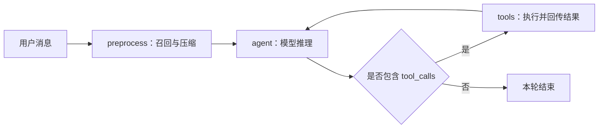

# 编码 Agent 项目：九条简历的源码讲解与面试准备

核对日期：2026-11-03。依据当前 `claude-code-agent/src` 实现及本地安装的 LangGraph 源码。本文件是代码讲解，不代表所有路径已完成端到端验证；没有修改业务代码。

阅读顺序：先理解第 1 条的调用循环，再理解第 2、3、4 条的执行过程，随后学习记忆、压缩、持久化、目标循环与预算。回答时分清“当前实现”“设计目的”和“下一步改进”，不要把规划中的能力说成已经完成。

## 代码导航

| 简历条目 | 主要代码入口 |
| --- | --- |
| 1. Agent 构建与编排 | [graph.py：构图](D:/研一/agent/claude-code-from-scratch-main/claude-code-agent/src/graph.py:611)、[state.py：状态](D:/研一/agent/claude-code-from-scratch-main/claude-code-agent/src/state.py:14) |
| 2. 工具集成与任务扩展 | [tools.py：工具声明](D:/研一/agent/claude-code-from-scratch-main/claude-code-agent/src/tools.py:34)、[skills.py](D:/研一/agent/claude-code-from-scratch-main/claude-code-agent/src/skills.py:45)、[mcp_client.py](D:/研一/agent/claude-code-from-scratch-main/claude-code-agent/src/mcp_client.py:53) |
| 3. 工具权限与人工审批 | [tools.py：权限规则](D:/研一/agent/claude-code-from-scratch-main/claude-code-agent/src/tools.py:402)、[graph.py：计划审批](D:/研一/agent/claude-code-from-scratch-main/claude-code-agent/src/graph.py:921) |
| 4. 代码修改与验证反馈 | [tools.py：先读后写](D:/研一/agent/claude-code-from-scratch-main/claude-code-agent/src/tools.py:585)、[graph.py：写后验证](D:/研一/agent/claude-code-from-scratch-main/claude-code-agent/src/graph.py:1023) |
| 5. 长期记忆与语义检索 | [memory.py](D:/研一/agent/claude-code-from-scratch-main/claude-code-agent/src/memory.py:41)、[embeddings.py](D:/研一/agent/claude-code-from-scratch-main/claude-code-agent/src/embeddings.py:12) |
| 6. 上下文管理与任务委派 | [graph.py：压缩](D:/研一/agent/claude-code-from-scratch-main/claude-code-agent/src/graph.py:1414)、[graph.py：子 Agent](D:/研一/agent/claude-code-from-scratch-main/claude-code-agent/src/graph.py:1073) |
| 7. 会话持久化与恢复 | [graph.py：Checkpoint](D:/研一/agent/claude-code-from-scratch-main/claude-code-agent/src/graph.py:641)、[session.py](D:/研一/agent/claude-code-from-scratch-main/claude-code-agent/src/session.py:64) |
| 8. 自主目标执行与反馈迭代 | [graph.py：目标循环](D:/研一/agent/claude-code-from-scratch-main/claude-code-agent/src/graph.py:1552)、[autonomy.py](D:/研一/agent/claude-code-from-scratch-main/claude-code-agent/src/autonomy.py:1) |
| 9. 调用容错与资源控制 | [graph.py：重试](D:/研一/agent/claude-code-from-scratch-main/claude-code-agent/src/graph.py:107)、[graph.py：预算](D:/研一/agent/claude-code-from-scratch-main/claude-code-agent/src/graph.py:1317) |

## 1. Agent 构建与编排

### 实际实现

真实注册的节点只有三个：`preprocess`、`agent`、`tools`。`_router` 是条件边调用的路由函数，不是第四个注册节点。



一轮用户消息的主要调用链：

```text
chat(user_message)
  → 历史消息 + HumanMessage
  → initial_state + thread_config
  → graph.astream(..., stream_mode="values")
      → _preprocess_node
      → _agent_node → _call_llm
      → _router
          → tools → agent → router ...
          → END
  → 更新内存会话、保存 JSON
```

`_preprocess_node()` 在本轮入口召回长期记忆、执行压缩，并在缺少系统消息时插入系统提示。工具循环从 `tools` 直接回 `agent`，不重新经过 `preprocess`。

`AgentStateDict` 使用 `TypedDict` 定义状态。其中：

```python
messages: Annotated[list[BaseMessage], add_messages]
```

`add_messages` 按消息 ID 合并：新 ID 追加，相同 ID 更新；不是任何新列表都会覆盖整个历史。其他没有指定 reducer 的字段使用默认更新规则。`TypedDict` 本身是类型描述，不能当作运行时参数校验器。

当前节点既读取图状态，也读取和修改 `self` 属性。例如模型客户端在 `self._llm`，权限在 `self.permission_mode`，计费统计也保存在实例上。不能说已经实现“所有状态都由图统一管理”或“节点都是纯函数”。

### Function Calling 的一次完整过程

1. 工具定义包含 `name`、`description`、`input_schema`。
2. `_tool_to_openai_format()` 转成 function 格式，`bind_tools()` 交给 LangChain 模型适配层。
3. 模型生成工具名和参数，结果归一到 `AIMessage.tool_calls`。
4. `_router()` 看有没有 `tool_calls`，决定进入工具节点或结束。
5. 应用程序真正执行工具，生成带 `tool_call_id` 的 `ToolMessage`。
6. 下一次模型请求携带工具结果，由模型继续决定动作或生成回答。

这里模型负责提出调用，Python 程序负责执行；`bind_tools()` 不等于自动执行工具。工具调用 ID 用来关联同一轮中多个调用及其返回结果。

### 两种流式输出不要混淆

- `graph.astream(..., stream_mode="values")`：取得节点执行后的状态事件。
- `llm_with_tools.astream(msgs)`：取得模型的响应分片，用于文字逐步显示。

当前代码累积分片并合并响应，工具在完整模型响应返回之后才进入执行节点。不是一边收到不完整的工具参数一边执行工具。

### 可以这样回答

> 我把编码 Agent 的核心循环拆成预处理、模型推理和工具执行三个节点。预处理负责召回项目记忆和处理上下文，模型节点通过工具 Schema 生成回复或结构化调用，条件边根据 tool_calls 决定是否进入工具节点。执行结果包装成 ToolMessage 回到模型，使工具结果参与下一步决策。消息通过 add_messages 按 ID 合并，图状态流和模型文本流分别处理。

### 常见追问

**为什么使用 LangGraph，自己写 while 循环不行吗？**

可以自己写循环。选 LangGraph 的理由是后续需要显式状态、条件分支、检查点和人工中断，图结构让执行位置与恢复机制有统一表达。不能说“while 循环无法实现”；这是复杂度和维护成本的取舍。

**这是 ReAct 吗？**

可以说采用类似 ReAct 的“模型决策—动作—观察反馈”循环。但当前没有要求模型输出固定的 Thought / Action / Observation 文本，也不依赖解析思维链字符串。

**模型什么时候结束？会不会还没完成就停？**

内层路由在模型不返回工具调用时结束本轮。这只能说明模型停止调用工具，不能证明用户目标已完成。第 8 条在外层增加 Judge 评估，区分“本轮回答结束”和“目标达成”。

**模型后端如何适配？**

`_create_llm()` 选择 `ChatOpenAI` 或 `ChatAnthropic`，工具和消息使用 LangChain 的统一表示。注意当前 CLI 入口实际以 DeepSeek 环境变量构造 OpenAI 兼容客户端；Anthropic 路径主要在核心类中实现，不能声称所有 CLI 切换路径均已验证。

### 当前边界

- `_create_llm()` 会参考 `OPENAI_API_KEY`，但 `self.use_openai` 仅由 `api_base` 判断，两处判断可能不一致。
- 图状态与实例状态并存，持久化不会自动保存 Python 实例的全部属性。
- 内层模型是否完成工作和任务是否真正完成是两个问题。

## 2. 工具集成与任务扩展

### 实际实现

基础工具是 Python 执行函数，声明和执行逻辑分开。`execute_tool()` 按工具名找到 handler，将同步文件与子进程操作放到 `asyncio.to_thread()`，避免直接阻塞事件循环。

三类扩展需要区分：

| 机制 | 执行方式 | 适用场景 |
| --- | --- | --- |
| 普通工具 | 调用 Python 函数或执行命令 | 文件读写、检索、Shell |
| Skill | 把流程模板返回给主 Agent，再由主 Agent 调工具完成步骤 | 代码审查、提交、记忆保存 |
| MCP | 通过进程管道向服务发 JSON-RPC | 接入外部工具服务 |

### Skills 如何工作

`_discover_skills()` 扫描内置 `.claude/skills/*/SKILL.md`，解析 frontmatter 的名称、描述和使用时机以及正文，保存在进程缓存。

`build_skill_descriptions()` 只把简短元数据放入 `skill` 工具描述。模型调用 `skill` 后，`execute_skill()` 找到定义、替换 `$ARGUMENTS`，再将完整流程作为工具结果返回。

因此“按需加载”指完整流程按需进入模型上下文；当前发现阶段已经读取了文件全文，并不是磁盘层面直到使用时才读取正文。Skill 也不会生成独立 Agent 实例。

### MCP 如何工作

```text
load_and_connect
  → 启动配置中的服务子进程
  → initialize 请求
  → 校验协议版本 + notifications/initialized
  → tools/list 获取 Schema
  → 添加 mcp__服务名__工具名 前缀
  → 加入主 Agent 工具列表

模型调用 MCP 工具
  → 解析命名空间
  → tools/call(name, arguments)
  → 后台 read_loop 按响应 id 找 Future
  → 返回文本工具结果
```

当前传输方式是进程 stdin/stdout 管道，JSON 按行传输；不是 HTTP 或 Streamable HTTP。请求包含 ID，通知没有 ID、不等待响应。初始化及工具发现各有超时，某个服务初始化失败会清理其连接并继续尝试其他配置。

### 并发工具如何调度

`_tools_node()` 把调用队列中连续的 `read_file / list_files / grep_search` 收集成一批，用 `asyncio.gather(return_exceptions=True)` 并发执行。其他工具按原队列串行执行。

例如 `[read A, read B, edit A, read C]` 会先并发读 A/B，再修改 A，再读取 C。它不是能自动分析任意工具依赖的 DAG 调度器。

### 可以这样回答

> 工具层分为直接执行的基础工具、描述任务流程的 Skills 和通过协议接入的 MCP 工具。Skills 复用流程但仍由主 Agent 执行；MCP 客户端负责进程通信、握手、Schema 发现和响应关联。只读基础工具可以批量并发，写入等有副作用的操作保持串行。

### 常见追问

**有 Function Calling，为什么还需要 MCP？**

Function Calling 表达模型要调用什么工具及参数；MCP 解决应用如何发现并连接外部工具服务。发现来的 MCP 工具仍需要转换为模型能理解的工具定义。两者处于不同环节。

**为什么请求需要 Future？**

写入请求和读取响应由不同协程负责。调用方等待 Future，后台读取协程按 ID 将响应交给对应 Future，使乱序响应也能对应到等待方。

**Skill 和子 Agent 的区别？**

Skill 在主上下文中补充流程；子 Agent 创建新的实例与消息上下文。前者主要复用步骤，后者主要隔离探索过程。

### 当前边界

- 工具 Schema 不是所有执行入口的完整运行时校验，部分基础 handler 主要依赖取参数时的异常处理。
- `_send_request()` 在写入并 `drain()` 后才注册 Future，存在很快返回的响应先于注册到达的潜在竞态；应先注册再发送。
- 初始化与发现有超时，但普通 `tools/call` 当前没有统一调用超时。
- 当前主要提取 MCP 文本结果，不是完整支持所有内容类型与服务能力。
- 不要声称已实现 MCP 自动重连、任意协议版本兼容或复杂任务 DAG 调度。

## 3. 工具权限与人工审批

### 实际实现

`allow / ask / deny` 是三种决策结果，不是管理员、用户等三种角色等级。更准确的理解是操作级策略。

对于进入 `check_permission()` 的调用，实际检查顺序是：

1. 配置中的 deny 规则，命中直接拒绝。
2. plan 模式，只允许计划文件写入、探索子 Agent、记忆搜索和白名单 MCP 等。
3. Shell 删除命令的项目外路径近似拦截。
4. bypassPermissions 模式，跳过后续交互确认。
5. 默认模式中记忆增删、危险 Shell、文件写入与编辑返回 ask。
6. 其余返回 allow。

普通确认路径是 `_execute_with_permission()` 调用 `_confirm_dangerous()`，使用 `confirm_fn` 或终端 `input()` 获取授权。当前没有为每个普通确认都调用 LangGraph `interrupt()`。

重要例外：三个只读基础工具在并发分支直接执行，绕过了 `check_permission()`。所以不能说“所有工具都统一受配置 deny 约束”。

### 计划审批路径

```text
enter_plan_mode
  → 保存之前权限模式
  → 设置 plan 模式与计划文件路径
  → 模型探索并写计划文件
exit_plan_mode
  → 读取计划正文
  → interrupt({type: plan_confirm, plan_content: ...})
外部 REPL 展示计划并收集选择
  → continue_with({confirmed: ..., mode: ..., feedback: ...})
  → graph.astream(Command(resume=...), 原 thread config)
  → 拒绝则继续计划，批准则恢复执行模式
```

### 可以这样回答

> 我把单次工具授权和任务计划审批分开。工具授权按操作返回允许、询问或拒绝；计划模式限制有副作用的操作，生成计划后通过 LangGraph interrupt 暂停，由外层界面获取审批结果，再用 Command 恢复。计划通过不意味着默认跳过后续工具确认，取决于恢复后的权限模式。

### 常见追问

**免确认模式是否完全没有限制？**

对经过权限入口的操作，配置 deny 和删除路径规则先于免确认判断，因此仍保留这些拦截。但只读工具目前有绕过统一入口的例外，不能回答成没有任何例外的安全保证。

**暂停后是否从 interrupt 后面那行直接继续？**

不是 Python 调用栈级别的暂停。根据本地 LangGraph 实现说明，恢复会重新运行被中断的节点，并让相应 `interrupt()` 返回恢复值。因此中断前的副作用可能重放，应该将审批单独成节点或让操作幂等。当前审批位于 tools 节点内部，同节点先前工具操作需要特别注意。

**危险命令能完全识别吗？**

不能。现在使用正则和命令字符串近似检查，不是 Shell 语法解析、操作系统沙箱或能力隔离。变量、脚本、复杂命令组合都可能绕过启发式识别，也可能误拦截。

### 当前边界

- `_delete_outside_project()` 检测删除关键词及 `/`、`..`、Windows 盘符等文本模式，并未解析实际执行目标；不要说已实现完整路径安全证明。
- 自动 Git 提交及 Python 写后执行直接走内部 subprocess，不都经过交互式工具权限入口。
- 计划模式初始化与持久化恢复还有第 7 条列出的实现问题。

## 4. 代码修改与验证反馈

### 实际实现

建议将简历的“实现读写机制”改为“实现先读后写校验”，因为前者太泛。

```text
read_file
  → 返回带行号文本
  → 记录绝对路径及 mtime
write_file / edit_file
  → 若文件已存在，检查是否读取过
  → 检查当前 mtime 是否与记录一致
  → edit_file 查找唯一 old_string
  → 对新 Python 源码执行 compile
  → 写入磁盘并返回修改预览 / Diff
  → graph 层直接运行 Python 文件（15 秒超时）
  → stdout / stderr / 退出码作为工具结果回到模型
```

新文件不要求先读；已有文件写入或编辑要求先读。`_find_actual_string()` 优先精确匹配，失败时尝试引号归一化。匹配不到或匹配多处就返回错误，不随机选择一个位置修改。

### 两阶段校验分别能发现什么

| 阶段 | 实现 | 能发现 | 不能据此保证 |
| --- | --- | --- | --- |
| 写前 | `compile(content, file_path, "exec")` | Python 语法错误 | 类型正确、依赖存在、业务正确 |
| 写后 | `subprocess.run([sys.executable, file_path], timeout=15)` | 执行时异常、部分 import 失败、超时 | 所有分支正确、测试覆盖完整 |

`compile(..., "exec")` 是编译检查，不是执行源码；写后验证才真正运行程序。当前不是执行 pytest 全套用例，也没有自动回滚写入。

### 可以这样回答

> 文件修改前要求模型读取现有内容，并记录 mtime；若外部程序改动过文件，就要求重新读取。局部替换必须唯一，避免误改多个位置。Python 写入前先做语法编译检查，写入成功后再运行文件，将错误作为工具观察结果交回模型，形成修改与验证的反馈流程。

### 常见追问

**mtime 能完全避免并发覆盖吗？**

不能。当前是写入前的冲突检测，检查与写入之间仍有时间窗口；时间戳精度也有限。改进可以用内容哈希或版本号比较，结合文件锁、临时文件与原子替换。不要把当前实现说成完整事务或锁。

**运行失败会恢复原文件吗？**

不会自动恢复。错误会返回给 Agent，由后续编辑修复。Git 记录可辅助人工追溯，但不等于执行失败时的自动回滚。

**所有 Python 文件都适合直接运行吗？**

不适合。服务入口、交互程序、需要特定工作目录的模块或存在副作用的脚本都可能不适用。下一步应该区分静态检查、项目测试和获准执行入口。

### 当前边界

- 写后验证直接执行本地 Python，不是沙箱运行。
- 当前成功与失败判断依赖字符串前缀。外部修改检查返回 `Warning:` 时，写后层没有把它统一视为失败，可能运行并未成功修改的文件；应改为结构化执行结果。
- 没有证明所有生成错误都能自动修好，也没有测得错误率下降百分比。
- Diff 是实现的简易替换差异文本，不要声称具备完整语义合并能力。

## 5. 长期记忆与语义检索

### 实际实现

`MemoryStore` 根据启动目录绝对路径生成 SHA-256 摘要作为项目 alias 的一部分。在同一个 Milvus 端点和数据库中，不同启动目录对应不同记忆集合。移动目录会改变项目身份；不是自动寻找 Git 仓库根目录。

四类记忆是同一集合里的 `type` 字段值：`user / feedback / project / reference`，不是四个独立集合。`user` 类型也按项目隔离，不是全局用户画像。

| 字段 | 用途 |
| --- | --- |
| id | 记忆主键，用于更新与删除 |
| type | 四类记忆标签 |
| content | 独立事实或完整经验正文 |
| vector | 正文的向量表示 |

`EmbeddingClient` 使用本地 Sentence Transformers 模型，进程内复用已加载模型，通过线程执行编码。`local_files_only=True` 禁止缺失文件时自动联网下载，模型缺失会报错。

### 读取路径

```text
本轮 HumanMessage
  → preprocess 取用户内容与消息 ID
  → search_memories(query)
  → 本地 Embedding + 向量归一化
  → Milvus HNSW / COSINE 搜索
  → 默认取 5 个候选，再过滤 score < 0.35
  → 格式化记忆，记录 JSON 大致受 8000 字符预算约束
  → _messages_with_memory 修改本轮用户消息副本
  → 发送模型请求
```

因此“Top-5”实际是最多五条，经过阈值及长度过滤可能更少，也可能为空。不是每种类型各取五条，字符预算也不是 Token 预算。

注入内容作为历史数据标识，明确提示当前用户纠正优先。仅修改请求副本，不改基础 SystemMessage，不把召回文本写入历史 JSON 或 Checkpoint。用当前 HumanMessage 的 ID 定位输入，避免工具结果跟在后面时注入错消息。

### 写入路径

`remember` Skill 引导模型提取独立事实，逐条搜索、比较和选择跳过 / 更新 / 新增。随后 `memory_save` 经过权限确认，由 `save_memory()` 校验参数、编码向量、写入 Milvus。

- 语义查重与纠正判断主要由 Skill 提示下的模型完成。
- 存储层另外对同类型、完全相同正文做精确去重。
- 正文和向量存同一实体，更新时一起 upsert，删除时一起删除。
- 写入后设置 `_memory_dirty`，下一次主推理请求前重新召回。
- 一条保存失败不回滚其他已保存记忆，不是多条记忆的统一事务。

### 索引选择与重建

代码中的 HNSW 建索引参数是 `M=16`、`efConstruction=128`，查询 `ef=max(64, top_k)`；它们是当前配置值，没有证据说明已找到最优配置。HNSW 用于近似搜索，COSINE 用来度量向量方向的相似程度。不同模型的分数分布不同，`0.35` 需要样例校准。

模型身份记录在 schema 描述中，并检查向量维度；变更后要求 reindex。重建流程是读取快照、重新编码、加锁核对旧数据未变化、构建新集合、比对内容、切换 alias，最后清理旧集合。失败发生在切换前时保留原集合继续使用。

### 可以这样回答

> 我把长期记忆存成带类型、正文和向量的 Milvus 实体，按项目目录隔离。每轮用户输入先编码，再做 HNSW 余弦近邻检索，过滤低相关结果后只注入本次模型请求。写入由记忆 Skill 引导逐条提取、搜索和更新，并受权限控制。更换 Embedding 模型时需要重建向量索引，通过新集合校验后再切别名，避免直接破坏现有记忆。

### 常见追问

**这是 RAG 吗？**

可以说采用检索增强思路，但语料是用户与项目长期记忆，不是完整文档知识库。当前没有文档切块流水线、混合检索或重排模型，不要展开成实现过这些能力。

**为什么四类放一个集合？**

四类记录共享结构，也希望跨类型统一检索，使用 type 字段即可。项目级隔离用集合 alias 实现。数据量增大后可以评估分区或共享集合加项目过滤，但这是未来取舍。

**模型幻觉会不会被保存成记忆？**

存在风险。当前依靠 Skill 要求只保留已确认事实、查重比较，以及写入授权；这不等于已经实现事实验证。可以增加来源、时间、用户确认状态和过期机制。

**本地 Embedding 是否保证数据完全不出机器？**

只保证向量生成在本地。记忆正文和向量仍会发送到配置的 Milvus；召回后还会随推理请求发送给模型服务。不能回答“所有数据都离线”。

**并发写入如何处理？**

本机共享项目目录使用文件锁；更新时将编码前读到的事实与当前值比较，变化则拒绝覆盖。文件锁不协调其他机器，Strong consistency 也不是跨客户端的完整事务锁。

### 当前边界

- 自动发生的是每轮召回，当前没有独立节点强制每轮执行记忆抽取和写入。
- 模型身份主要包含本地路径，原地替换同一路径下权重不一定被识别，不能声称检测了模型内容哈希。
- 未测得召回率、准确率或个性化效果提升数据。
- 召回失败会清空本轮记忆并让对话继续；显式搜索工具失败则向 Agent 返回错误，不能把检索失败当作没有旧记忆。

## 6. 上下文管理与任务委派

### 实际实现

这里是“三类工具结果处理 + 一类 LLM 摘要”四类策略，不是严格依次执行、每一级都会触发的四级算法。

| 策略 | 实际触发条件 | 处理 |
| --- | --- | --- |
| 空闲清理 | 距上次模型调用至少 5 分钟 | 仅保留最近 3 条有效工具结果，其余改占位符 |
| 利用率裁剪 | 利用率至少 75% | 最近 3 条之外的有效工具结果替换为可重读提示 |
| 长结果截断 | 利用率超过 50% | 单个工具结果保留首尾；超过 70% 时使用更小字符预算 |
| LLM 摘要 | 上次调用 Token 超过有效窗口 85%，且消息数不少于 5 | 总结历史并重建消息列表 |

长结果预算当前是 30000 / 15000 字符，不是 Token。有效窗口是模型配置窗口减去 20000 的固定预留；利用率依据上次调用输入加输出 Token 近似估算，不是发送前对全部请求精确分词。

还有一个独立机制：工具结果超过 30 KB 时落盘，返回路径和前 200 行预览，并再次约束返回文本长度。它是结果进入上下文时的体积控制，不能混同于历史摘要。

### 摘要重建

`_compact_conversation()` 调用未绑定工具的模型，总结关键决策、路径和上下文，然后重建为：

```text
SystemMessage（含计划模式要求）
HumanMessage（历史摘要）
AIMessage（确认已有上下文）
最后一条原始 HumanMessage
```

在当前入口，最后一条通常就是新用户消息，因此保留用户最新要求。源码通过原地清空状态消息列表再追加新消息实现；本次最小图验证中，新列表保留且旧消息被移除。不过这种依赖原地变更的写法不适合直接推广，明确使用删除消息 / 重置机制更易维护。

### 子 Agent 如何工作

`get_sub_agent_config()` 返回探索提示词及三个只读工具。`_execute_agent_tool()` 创建新的 `CodingAgent`，设置独立提示词、工具集、`is_sub_agent=True` 和 `max_turns=30`。

它没有继承主 Agent 全部聊天历史，主要接收委派 prompt；不会初始化 MCP、用户长期记忆或主 Agent 的 Git 自动提交逻辑。主 Agent 等待子任务执行完成，再将其文本当作一个工具结果。

上下文隔离真实存在，但当前 `_run_once()` 拼接的是子 Agent 收集到的所有文本输出，不是通过结构化机制严格限定为最后一条总结。可以说减少中间工具结果进入主上下文，不能保证只返回一句精炼结论。

### 可以这样回答

> 我从输入体积、历史压缩和任务委派三个层面管理上下文。大结果先落盘，只返回预览；在每轮用户输入时，根据窗口占用与空闲时间处理旧工具结果，必要时用模型摘要保留关键决策。需要读大量文件时，派给具有独立上下文和只读工具集的探索子 Agent，使其过程中的工具结果不直接堆积进主会话。

### 常见追问

**能保证永远不会超窗口吗？**

不能。当前压缩在用户轮次入口执行，长时间的同一轮工具循环不再次经过预处理；上次 Token 用量只是近似信号。应在每次模型调用前估算输入、预留输出，并在工具循环内触发压缩。

**摘要会丢信息吗？**

可能丢失。当前提示词要求保留关键决策与路径，但没有严格信息保真度验证。可以保留结构化任务状态、文件索引、未完成事项，并提供按需重读。

**子 Agent 为什么不用写工具？**

它定位为探索角色，最小工具集让其职责明确，避免与主 Agent 并发修改文件。只读来自实际暴露的工具集合，不只是系统提示词约束。

**为什么只读子 Agent 可以免确认？**

其模型只绑定三种只读工具，不暴露写入与 Shell 工具。当前仍不是独立进程或操作系统级沙箱，不能把上下文隔离说成系统权限隔离。

### 当前边界

- 不支持复杂多角色协作、多个子 Agent 的通用并行调度或结果仲裁。
- 子实例传入模型名，但没有完整继承主实例自定义 API 地址与密钥配置；可能依赖环境变量，不能保证任意后端配置均能正确继承。
- 子任务输入输出 Token 在结束后合并到主统计，但其缓存分类和执行中的全局预算并不完整。
- 截断、清理和摘要都有信息损失，不能写成“保证上下文完整”或“绝不溢出”。

## 7. 会话持久化与恢复

### 三种存储各自负责什么

| 载体 | 存什么 | 用途 |
| --- | --- | --- |
| LangGraph Checkpoint / SQLite | 图运行状态、任务位置、中断相关信息 | 图执行恢复 |
| 会话 JSON | 序列化消息和会话元数据 | 历史对话续聊 |
| Milvus | 提取出的独立长期事实及向量 | 跨会话语义召回 |

不能说 JSON、Checkpoint、长期记忆只是同一个东西的三个副本。

### 实际代码路径

`_build_graph()` 创建 `AsyncSqliteSaver`，将其传给 `workflow.compile(checkpointer=...)`，SQLite 初始化失败时回退到内存 saver。`chat()` 将 `session_id` 放到 `configurable.thread_id`，用于关联图线程。

`continue_with()` 使用原来的 thread config 和 `Command(resume=...)` 恢复中断。`resume_latest()` 则扫描会话 JSON，按开始时间取最近会话，反序列化消息并放回 `_conversation_messages`，不是自动扫描 Checkpoint 恢复未完成任务。

### 可以这样回答

> 我把历史续聊和执行恢复分开设计。会话 JSON 用来重建聊天消息，Checkpoint 用来保存图执行所需的状态和中断位置，两者通过会话标识关联。长期记忆另存 Milvus，保存提取后的事实而不是完整消息。目前持久化的框架接入已经写出，但 SQLite 生命周期与实例状态恢复仍有需要修复和验证的地方。

### 本次核对发现的实际问题

1. `_build_graph()` 在临时事件循环中创建 `AsyncSqliteSaver`，随后关闭该循环。本地 saver 会记录创建时的循环；本次最小复现输出 `saver_recorded_loop_closed: True`，后续同步桥接会依赖已经关闭的循环。
2. 在已有异步事件循环内调用当前构建方式，会尝试再运行另一个事件循环，并被异常分支吞掉，回退到内存 saver；本次最小复现的类型为 `InMemorySaver`。
3. `chat()` 和 `continue_with()` 内使用同步 `get_state()`。异步 saver 应配合 `await aget_state()` 使用；当前读取中断时吞异常，可能导致审批发现失败。
4. 构造函数在基础会话字段初始化之前执行 `resume_latest()`，之后又重新赋值 `session_id` 和开始时间，可能覆盖已恢复身份。首次 `--plan` 初始化也可能在 `session_id` 存在之前生成计划路径。
5. 实际权限、读文件状态、费用与目标状态有不少保存在 `self`，仅保存同名图字段不能保证重启后业务对象完整恢复。
6. JSON 保存是直接覆盖写入，没有临时文件原子替换；中途崩溃可能留下不完整记录。

这些问题意味着目前不宜把“可靠跨进程恢复任意长任务”作为已验证成果。

### 常见追问

**SQLite 连接应该如何管理？**

建议在主异步生命周期中使用异步工厂或上下文管理器创建 saver，让图执行、状态读取与连接清理处在同一有效事件循环内，停止时显式关闭。关键是生命周期一致，而不是只改一个文件路径。

**Checkpoint 能保证工具只执行一次吗？**

不能直接保证外部副作用恰好一次。中断恢复、重放或故障重试可能再次执行动作，需要业务幂等键、执行记录、独立审批节点等机制。

**为什么用 SQLite？**

单机 CLI 场景部署简单、无需独立数据库服务。多实例并发和服务化需求增加时可评估更适合共享存储的持久化后端，但当前没有实现分布式恢复。

### 面试前处理建议

这条优先修复再做断电 / 重启 / 中断审批端到端验证。如果来不及，明确表述为接入 Checkpoint、支持会话记录加载，并如实说明尚待完善的恢复边界。

## 8. 自主目标执行与反馈迭代

### 实际实现

这是套在内层 Agent 循环之外的目标循环：

```text
用户目标 → chat(启动指令)
    ↓
取最近一条助手文本 → Judge 单独评估
    ├─ ok=true → 结束
    ├─ impossible=true → 结束
    └─ 未达成 → 保存 reason
                  → 检查预算、最大迭代、用户停止
                  → chat(未达成原因 + 继续指令)
                  → 再评估
```

`_evaluate_goal()` 使用同一个 `self._llm`，另建裁判提示和消息，不绑定执行工具。因此是独立评估调用 / 独立裁判角色，不是部署了另一个不同模型。

输入证据来自 `_extract_last_assistant_text()`，目前只取最近一条非空助手消息，不包含完整工具轨迹、实际文件内容或自动重跑测试结果。

裁判输出经 `parse_goal_verdict()` 校验，要求 `ok` 是布尔值且 `reason` 非空；无法解析或矛盾输出按未达成处理，避免随意把异常当成功。

### 可以这样回答

> 内层 Agent 在没有工具调用时结束一轮，但这不一定代表目标已经达成。我在外面增加目标循环：每轮结束后发起单独的 Judge 调用，要求输出达成状态与原因；未达成时把缺失原因反馈给 Agent 继续工作，达成、判定不可完成或触及执行限制时退出。当前 Judge 复用同一模型，证据主要来自最后一条助手输出。

### 常见追问

**同一模型当裁判，有意义吗？**

角色和提示分离能增加显式检查步骤，但不能消除同源偏差。当前是工程上的反馈机制，不是客观正确性的保证。可以增加测试退出码、生成文件检查等可验证证据，必要时使用不同模型交叉评估。

**Agent 说“测试已通过”，Judge 就相信了吗？**

目前存在这种误判风险，因为证据主要是助手文本。更可靠的方式是结构化收集真实工具结果，针对任务编写确定性验收条件，裁判只负责难以规则化的部分。

**不可能完成如何判断？**

当前由裁判给出 `impossible=true` 和原因，不是数学上的不可达证明。错误判断会提前停止，需要允许用户补充条件后重试。

**如何避免无限循环？**

有目标循环最大次数、每条消息工具轮数、估算费用和用户停止等限制。但目标外层和工具内层计数范围不同，费用也未全量覆盖，不能承诺严格的全局预算硬停止。

### 当前边界

- 活跃目标保存在内存，不是重启后自动恢复的持久目标系统。
- 没有通用的确定性成果验收器或保证成功率的数据。
- Judge 与摘要调用未通过统一计费路径；见第 9 条。
- 目标循环和计划中断的衔接需要单独测试，不能假设普通 `chat()` 暂停后外层就自动等到计划审批结束。

## 9. 调用容错与资源控制

### 重试实际实现

`_is_retryable()` 识别 429、503、529，以及少数网络错误文本；`_with_retry()` 默认最多三次重试，也就是包含首次在内最多四次尝试。

退避公式为：

```text
delay_seconds = min(2 ** attempt, 30) + random(0, 1)
```

默认重试次数下主要是约 1、2、4 秒加抖动。调用前和重试间隙检查中止状态，`CancelledError` 直接向上传播。SDK 级重试还可通过环境变量配置，可能与外层重试叠加。

### Token 与费用

主 Agent 的 `_agent_node()` 读取模型响应 usage 并累计。子 Agent 结束后会把输入输出 Token 合并回主 Agent，但没有完整合并子任务缓存分类；Judge 与摘要直接调用 `_llm.ainvoke()`，没有走同一套用量统计。

所以可以说“统计主推理及部分子任务用量”，不能说“所有调用均已精准计费”。

`_get_current_cost_usd()` 当前采用硬编码估算，DeepSeek 分支注释和数值使用人民币，函数名及预算选项却标为美元；非 DeepSeek 分支统一使用一套价格，没有对每个模型分别配置。不能把当前估算当成严格统一币种的账单。

### Prompt 缓存

`_add_cache_breakpoints()` 给 Anthropic 系统消息与末尾消息添加 `cache_control`，末尾可能是用户、助手或工具结果；它修改请求副本，不是本地缓存模型回答。实际是否命中、节省多少要看服务返回用量与实测。

### 三种限制的范围

| 限制 | 范围 | 检查位置 |
| --- | --- | --- |
| 工具轮数 | 每次 `chat()` 重置，一次进入 tools 节点计一轮 | 工具节点入口 |
| 费用 | 当前进程中实例累计的已统计费用 | 工具节点与目标续做前 |
| 目标迭代 | 一次 `pursue_goal()` 的外层迭代 | 目标循环 |

一轮里调用三个工具仍算一轮，不是三次工具调用。配置 `max_turns=N` 时，当前先加一再比较 `>=N`，会在第 N 次进入工具节点时拦截，实际最多执行 N-1 轮；这是边界问题，需要修正或明确语义。

### 可以这样回答

> 我对可重试的瞬态错误使用指数退避和随机抖动，取消异常直接退出。资源控制区分每条消息的工具轮数、目标循环次数和累计费用估算，在工具执行或继续目标前检查。Anthropic 路径还设置 Prompt 缓存断点。目前预算属于执行阶段的护栏，计费口径和全局硬停止仍需完善。

### 常见追问

**为什么加随机抖动？**

避免多个客户端同时失败后按完全相同时间点重试，缓解同步请求冲击。当前没有实现所有状态码统一重试，也没有严格遵循所有服务的 Retry-After。

**超预算以后还会继续请求模型吗？**

可能。工具超限时返回错误 ToolMessage，图仍会进入模型节点；如果模型继续提出工具调用，可能继续消耗推理请求直到其他限制生效。因此当前不是严格的预算终止路由。

**能保证单次调用不超过预算吗？**

不能。检查基于已经产生的估算费用，未为将要生成的 Token 做预占，单次长输出或子任务可能超支。更强实现应在模型调用前检查和预留预算，并统一统计 Judge、摘要和子 Agent。

**流式输出中途失败，重试有何问题？**

部分文本可能已经展示，再次请求可能重复输出，且失败尝试也可能产生费用。当前没有完整的流式回滚、断点续传和失败用量核算，不能声称透明无重复重试。

## 面试前优先处理的代码问题

以下是根据源码与最小复现得到的准备清单，不代表已修复：

1. 修复 SQLite saver 的事件循环生命周期、异步状态读取与审批恢复；验证真正的跨进程持久化。
2. 调整构造函数初始化顺序，避免恢复后会话身份被覆盖及初始计划路径过早生成。
3. 将实际业务状态与图状态的责任理清，确定恢复哪些属性，避免“图里有字段但运行只看 self”。
4. 统一工具权限预检；目前只读并发路径绕过配置 deny，自动 Git 和写后执行也没有统一授权入口。
5. 统一模型调用与计费入口，修正价格配置、币种和工具轮数边界；超预算直接停止相应执行路径。
6. 写工具使用结构化结果标记成功与否，避免字符串前缀判断导致不该运行的文件仍被执行。
7. MCP 先注册 Future 再发送请求，补齐工具调用超时、失联处理与取消清理。
8. 每次模型请求前检查上下文；为 Judge 添加真实工具证据及确定性验收条件。

## 本次验证记录

- 运行 `python -m unittest discover -s tests -p test_memory.py -v`，21 项全部通过。
- 这些是离线测试，使用模拟 Milvus，并在图集成测试中绕开 SQLite saver；不证明真实 Milvus 服务及 SQLite 恢复路径已通过。
- 最小图验证显示：当前原地清空状态消息列表的写法，在安装版本中会移除旧历史并保留摘要。单独调用 `add_messages(old, new_summary)` 则会保留旧消息，不能把 reducer 本身当作整表替换。
- 最小 saver 构建验证显示：同步构造后的 saver 记录了已关闭事件循环；运行中的异步上下文里构造则回退内存。没有将这个结果扩大解释为所有执行路径都经过端到端失败测试。
- 未调用付费模型，未对真实项目执行自动编辑、Git 提交、Shell 任务或记忆写入。

## 推荐的项目总述

> 我做的是一个基于 LangGraph 的编码 Agent，核心是模型决策与工具反馈循环。在这个基础上，我实现了 Skills 和 MCP 工具扩展、先读后写与 Python 两阶段校验、项目长期记忆、上下文压缩和只读探索子 Agent。执行控制包括工具授权、计划审批、目标评估循环以及轮数和预算护栏。当前主要完成单机原型，持久化恢复、全量计费和部分权限边界仍在完善中。

回答时先说明做了什么，再选择一个真实调用链讲清楚。面试官追问不足时，讲具体限制与改进方式，不用“完全可靠”“百分之百安全”“自主完成任何任务”等无法验证的表述。
